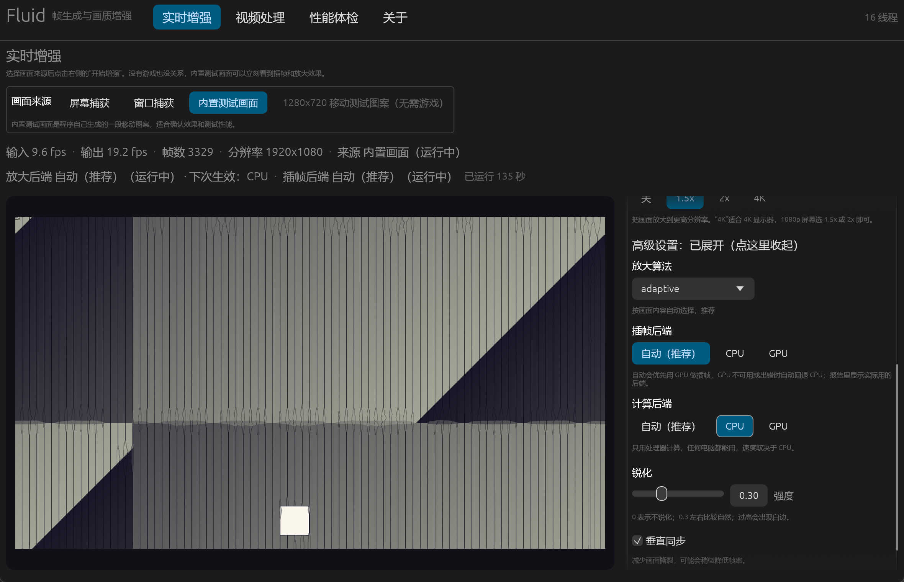

# Fluid

**通用实时插帧 + 超分辨率引擎，用 Rust 编写。**

Fluid 从屏幕、窗口、视频或任何画面源捕获帧，做运动估计与帧合成（插帧），再做超分辨率放大与锐化，最后把结果呈现到你自己的窗口里，或者写回视频文件。它不修改游戏、不修改视频、不注入任何进程 —— 只是一个外部的"画面搬运 + 增强"层。

目标是：**资源更少、延迟更低、画面更流畅、画质更接近原生高帧率高分辨率**，并且对任何游戏、任何视频、任何屏幕内容都生效，不需要开发者做任何集成。

```text
        捕获                分析                 合成                  放大                  呈现
  ┌─────────────┐    ┌──────────────┐    ┌──────────────┐    ┌──────────────┐    ┌─────────────┐
  │  DXGI 桌面   │    │ 金字塔块匹配  │    │ 运动补偿插帧  │    │ 自适应/时域   │    │  自建窗口    │
  │  复制 / 视频 │ →  │ 光流 + 遮挡   │ →  │  + 场景切换  │ →  │ 超分 + 锐化   │ →  │  / y4m/PNG  │
  │  / PNG 序列  │    │  检测        │    │  检测        │    │              │    │             │
  └─────────────┘    └──────────────┘    └──────────────┘    └──────────────┘    └─────────────┘
```

## 为什么它安全（为什么不是外挂）

Fluid 的设计原则是**完全在目标进程之外工作**：

- **不注入**：不加载 DLL 到游戏进程，不创建远程线程，不做 API Hook，不加载驱动。
- **不读内存**：不访问游戏内存、不读游戏文件、不修改游戏文件或视频文件。
- **不模拟输入**：v0.1 不发送任何键鼠事件，只采集屏幕像素。
- **只用系统公开接口**：Windows 上使用 DXGI Desktop Duplication 读取桌面，用 Win32 创建自己的窗口显示结果 —— 和录屏软件、直播软件属于同一类技术。

因此从反作弊的角度看，Fluid 就是一个屏幕采集与显示工具，而不是游戏外挂。**但请注意**：个别竞技游戏的服务条款可能限制任何第三方叠加/采集软件，是否允许请以该游戏的政策为准。Fluid 不提供、也永远不会提供任何绕过检测或反作弊的功能。

另外，DRM 保护的内容（例如部分流媒体）在桌面复制接口下由系统返回黑帧，Fluid 不解密、不绕过，这也是设计上的边界。

## 特性

- **零侵入、全场景**：任何游戏（包括老游戏、模拟器、浏览器、桌面、视频播放器、远程桌面）都能用，因为只依赖"屏幕上有什么"。
- **插帧 + 超分一体**：一条管线同时完成帧生成和分辨率提升，共享同一份运动信息，避免两套系统互相拖累。
- **低延迟优先**：默认 2 帧队列上限、单帧参考、可关闭 vsync、可选节流；所有延迟相关的旋钮都暴露出来。
- **画质可调**：5 档预设（ultra-performance → ultra-quality），每个阶段都能单独调参（光流金字塔层数/块大小/搜索半径/迭代次数、遮挡填充、场景切换阈值、缩放滤波器、缩放比例或目标分辨率、锐化强度、时域混合、历史帧数）。
- **轻量**：纯 Rust，无 GC、无运行时；Windows 上是两个单文件可执行（CLI + GUI），Android 上是同一套代码编译出的 `libfluid_gui.so` 加一个 Gradle APK 外壳。
- **安全优先**：核心 crate 禁止 `unsafe`（`#![forbid(unsafe_code)]`），平台相关代码的 `unsafe` 全部带 SAFETY 注释；所有 IO 错误统一为 `FluidError`，库代码不 panic。
- **可测量**：每个阶段都有纳秒级计时，输出 p50/p99 延迟、输入/输出 fps、插帧数量、场景切换次数，可导出 JSON。
- **视频离线处理**：内置 y4m 读写和 PNG 序列读写，零外部依赖；需要 mp4/webm 时用 ffmpeg 管道对接，Fluid 本身不捆绑解码器。
- **有图形界面**：`fluid-gui` 提供全中文的桌面应用（实时增强 / 视频处理 / 性能体检 / 关于），新手不用记参数；同一套代码可在 Android 上运行。

## 架构

Cargo workspace 共 10 个 crate，依赖方向严格单向（箭头指向被依赖者）：

```text
fluid-core       类型、配置、错误、日志、统计、Frame/亮度平面       ← 所有 crate 的基础
   ↑
fluid-flow       光流估计、遮挡检测、场景切换检测
fluid-interp     运动补偿帧合成
fluid-upscale    nearest/bilinear/bicubic/lanczos/adaptive/temporal + 锐化
fluid-capture    屏幕捕获（Windows DXGI / 窗口 WGC，Android MediaProjection，Mock 源）
fluid-present    呈现（DXGI 翻转交换链 / GDI 窗口，空 sink，Android ANativeWindow）
fluid-video      y4m 读写、PNG 序列、合成测试源
   ↑
fluid-engine     管线编排：FrameSource → FrameProcessor → FrameSink，节流与遥测
   ↑
fluid-cli        命令行工具 `fluid`
fluid-gui        图形界面（eframe/egui，桌面 + Android）
```

设计要点：

- `FrameSource` / `FrameSink` 两个 trait 把所有平台差异挡在引擎之外，引擎本身与平台无关。
- 捕获、处理、呈现三段式，任何一段都可以替换（例如未来加 Vulkan 计算后端或零拷贝 D3D11 路径）。
- 配置是纯数据（`FluidConfig`），可 TOML 序列化，CLI 参数只是它的覆盖层，方便做 GUI、脚本化和回归测试。

## 快速开始

环境要求：

- Rust stable 1.99 或更新（`rustup update stable`）
- Windows：Visual Studio 2022 Build Tools（MSVC 链接器）
- Android：NDK + `cargo-ndk`（见下文 "Android" 一节）

```powershell
# 构建（CLI + GUI）
cargo build --release -p fluid-cli -p fluid-gui

# 图形界面（新手推荐）
.\target\release\fluid.exe gui
.\target\release\fluid-gui.exe

# 单元测试（全部 crate）
cargo test --workspace

# 列出显示器与可用后端
.\target\release\fluid.exe devices

# 实时：捕获屏幕 → 2 倍插帧 → 不放大 → 显示在自己的窗口
.\target\release\fluid.exe run --multiplier 2 --scale 1.0 --preset performance

# 实时 + 超分：建议输入 720p，1.5 倍 Bilinear 放大到 1080p
.\target\release\fluid.exe run --multiplier 2 --scale 1.5 --filter bilinear --preset performance

# 离线视频：y4m 进 y4m 出（不依赖 ffmpeg）
.\target\release\fluid.exe video -i in.y4m -o out.y4m --multiplier 2 --scale 2 --filter lanczos

# 性能基准（合成画面，不需要显示器）
.\target\release\fluid.exe bench --size 1920x1080 --frames 240 --json

# 生成 / 校验配置文件
.\target\release\fluid.exe config --write fluid.toml
.\target\release\fluid.exe config --check fluid.toml
```

Linux / Android 上把 `.exe` 去掉即可，参数完全一致。不确定自己的机器该开什么参数？先跑 `fluid doctor`，它会实测并给出推荐命令行。

## 图形界面（GUI）

不想记命令行？直接开图形界面：

```powershell
.\target\release\fluid.exe gui        # 或直接双击 fluid-gui.exe
```



界面全中文，四个标签页：

| 标签页 | 做什么 |
|---|---|
| **实时增强** | 选「屏幕捕获」/「窗口捕获」/「内置测试画面」→ 选预设 / 插帧倍率 / 放大倍率 / 放大算法 / 计算后端 / 插帧后端 → 点「开始增强」，中间实时预览，可勾选「全屏输出」把结果满屏播放 |
| **视频处理** | 原生文件对话框选 y4m / MJPEG AVI 输入输出，离线插帧 + 放大，进度条 + 剩余时间，完成后可一键打开输出文件夹 |
| **性能体检** | 一键跑合成基准，告诉你这台机器适合开什么档位 |
| **关于** | 版本、许可证、配置路径、快捷键、安全说明 |

手机 / 平板 / 窄窗口下界面自动切换成单栏：预览在上、控制在下，底部固定「开始/停止增强」大按钮，所有可点控件不小于 44×44 点；窗口再窄（如 480×820、360×740）会切到紧凑模式（标签页收进下拉、按钮上下堆叠，不会被裁掉）。运行中改设置不会打断当前运行，状态条会写「下次生效：X」；被捕获的窗口关掉/最小化时会弹出提示卡片，可一键停止或重新选择。GPU 可用时插帧与放大都会自动走 GPU（`interp_backend: wgpu-flow`），在状态条和运行报告里都能看到实际后端。快捷键：`Ctrl+1`~`Ctrl+4` 或 `Alt+1`~`Alt+4` 切标签页，`空格` 开始/停止，`Esc` 在主窗口停止增强 / 在全屏输出窗口只关那个窗口。所有设置自动保存到 `%APPDATA%\Fluid\gui.toml`，与 CLI 共用同一份配置格式。

细节（每个控件的含义、常见问题、Android 上的情况）见 **[docs/GUI.md](docs/GUI.md)**。

## 命令行参考

```text
fluid [全局选项] <命令> [命令选项]
```

全局选项：

| 选项 | 说明 |
|---|---|
| `--config FILE` | 加载 TOML 配置文件（不指定则用默认值） |
| `--log-level LEVEL` | `off / error / warn / info / debug / trace`，默认 `info` |
| `--quiet` | 减少输出 |
| `--json` | 以 JSON 输出结果（便于脚本调用） |

### fluid run —— 实时屏幕管线

| 选项 | 说明 |
|---|---|
| `--capture auto\|dxgi\|mock` | 捕获后端，`mock` 是合成测试画面 |
| `--monitor N` | 显示器序号（先跑 `fluid devices`） |
| `--region WxH+X+Y` | 只捕获屏幕的一块区域，例如 `1280x720+100+50` |
| `--window <标题>` | 只捕获标题包含这段文字的窗口（列表见 `fluid devices --windows`） |
| `--window-process <进程名>` | 只捕获某个进程的窗口，例如 `notepad.exe` |
| `--window-id <ID>` | 只捕获指定 id 的窗口（最精确，适合多开同一程序） |
| `--no-present` | 只捕获和处理，不开窗口（压力测试/调试） |
| `--no-cursor` | 不把鼠标画进捕获帧 |
| `--present-fps HZ` | 输出帧率上限，0 表示不限制 |
| `--frames N` | 处理 N 个源帧后停止 |
| `--report FILE` | 结束时把 JSON 报告写到文件 |

### fluid video —— 离线视频处理

```text
fluid video -i input.y4m -o output.y4m [选项]
fluid video -i frames_in/ -o frames_out/ [选项]
fluid video -i - -o -    # 从 stdin 读 y4m、往 stdout 写 y4m，可夹在 ffmpeg 管道中间
```

输入可以是 y4m 文件（8-bit 以及 10-bit `p10`，10-bit 截断到 8-bit）、MJPEG `.avi` 文件（不需要 ffmpeg）或 PNG 序列目录；输出可以是 y4m、MJPEG `.avi` 或 PNG 序列目录。输出 y4m 会自动把帧率写成 `输入帧率 × 插帧倍率`，保证播放速度正确。

没有 ffmpeg 也能直接导出 `.avi`（MJPEG 编码，Windows 自带播放器 / Media Foundation、VLC 都能播放）：

```bash
fluid video -i input.y4m -o output.avi [--jpeg-quality 88]
```

AVI 自带正确帧率（`输入帧率 × 插帧倍率`），单文件上限 4 GiB；长视频或 1080p 以上建议还是用下面的 ffmpeg 脚本（H.264/H.265 体积小一个数量级）。

处理普通视频（mp4/mkv/mov…）用仓库里的封装脚本，它会自动用 ffmpeg 解码、调 `fluid video`、再编码回 H.264/H.265（音频原样保留）：

```bash
# Windows
powershell -ExecutionPolicy Bypass -File scripts\video-enhance.ps1 -In in.mp4 -Out out.mp4 -Multiplier 2 -Scale 1.5
# Linux / macOS / Termux
./scripts/video-enhance.sh -i in.mp4 -o out.mp4 -m 2 -s 1.5 -c h265
```

功能、参数组合、HDR/10-bit 限制和排错见 [docs/VIDEO.md](docs/VIDEO.md)。

### fluid bench —— 合成基准测试

```text
fluid bench --size 1920x1080 --frames 240 --warmup 10 --json
```

不带任何画质参数时，默认跑"2 倍插帧 + 1.5 倍 Bilinear 放大"，这样基准测的是真实管线而不是空转。

### fluid doctor —— 一键体检 + 推荐参数

```text
fluid doctor                 # 检查环境，跑 4 档配置，给出适合本机的参数
fluid doctor --json          # 机器可读输出（CI / 脚本用）
fluid doctor --target-fps 90 # 想冲到 90 fps 就按这个目标推荐
```

它会打印 CPU 线程数、显示器、捕获/呈现后端可用性、GPU 后端，然后用合成源实测 4 档典型配置（720p 超分、720p 插帧+超分、1080p 插帧、1080p→4K 超分）各自能跑多少帧，最后挑出"在你的目标帧率下最激进的可行情景"，直接给出可以复制的 `fluid run ...` 命令。买机器、换分辨率、纠结开不开插帧时先跑这个。

### 只捕获一个窗口（推荐，比全屏省很多）

整屏捕获在 2K/4K 屏上像素太多（见性能章节），而绝大多数游戏只需要抓它自己的窗口。Fluid 支持直接按窗口捕获，而且用的是 Windows.Graphics.Capture，**窗口被别的窗口挡住也能抓到真实内容**，不需要注入、不需要 hook：

```bash
# 1. 看看有哪些窗口（前台窗口排在最前面，带进程名和尺寸）
fluid devices --windows

# 2. 按进程取（最省事，同一个游戏多开时用 --window-id）
fluid run --window-process game.exe --multiplier 2 --scale 1.0 --preset performance

# 3. 或者按标题片段
fluid run --window "原神" --multiplier 2 --filter bilinear --scale 1.5
```

窗口捕获的输出尺寸在打开时固定：窗口移动会跟着走，窗口缩放会把内容裁剪/补黑边（重新开始即可换成新尺寸），最小化或窗口关闭时会重复最后一帧而不是报错。如果 WGC 初始化失败，会自动退化为“DXGI 抓整个屏幕再裁出窗口区域”：能工作，但被遮挡的部分和鼠标指针会不准确，日志里会显示 `window-dxgi-crop`。

图形界面里同样有这一项：实时增强 → 画面来源选 **窗口捕获** → 在列表里搜索/点选窗口 → 开始增强（见 [docs/GUI.md](docs/GUI.md)）。

### fluid devices / fluid config / fluid info

- `devices`：列出显示器（物理像素，已声明 DPI 感知）、捕获后端、呈现后端、GPU（wgpu 选中的图形 API 与显卡名）、默认配置摘要；加 `--windows` 还会列出可捕获的窗口（前台优先，带进程名、尺寸、位置），供 `fluid run --window/--window-process/--window-id` 使用。
- `config`：打印带注释的配置模板；`--write FILE` 写入；`--check FILE` 校验并输出规范化结果；`--effective` 显示叠加 CLI 覆盖后的最终配置。
- `info`：版本、目标平台、默认 1080p 处理计划。

### 画质 / 延迟选项（run、video、bench 通用）

| 选项 | 说明 |
|---|---|
| `--preset <名称>` | `ultra-performance / performance / balanced / quality / ultra-quality` |
| `--interp off\|fixed\|adaptive` | 插帧模式；`fixed` 固定每帧生成 N-1 张，`adaptive` 按时间预算决定 |
| `--multiplier N` | 每个真实帧生成 N 帧（N=1 等于关闭插帧，N=2 是最常用档） |
| `--scale FACTOR` | 相对源分辨率放大倍率，例如 `1.5`、`2.0`；`0` 关闭放大 |
| `--target WxH` | 直接指定输出分辨率 |
| `--filter <名称>` | `off / nearest / bilinear / bicubic / lanczos / adaptive / temporal` |
| `--backend <名称>` | 放大后端：`auto`（默认，有可用 GPU 就用 GPU）/ `cpu` / `gpu` |
| `--interp-backend <名称>` | 插帧（帧生成）后端：`auto`（默认，优先 GPU，不可用自动回退 CPU）/ `cpu` / `gpu` |
| `--sharpness 0..1` | 锐化强度 |
| `--temporal / --no-temporal` | 开关时域（历史帧）放大路径 |
| `--present-backend <名称>` | 呈现后端：`auto`（默认，优先 DXGI 翻转交换链，失败回退 GDI 窗口）/ `window`（GDI，兼容性最好）/ `dxgi`（翻转模型，延迟更低、支持真正的 vsync/撕裂） |
| `--vsync / --no-vsync` | 呈现是否垂直同步 |
| `--fullscreen / --borderless` | 预览窗口形态 |
| `--max-queue N` | 最大在途帧数，1 = 最低延迟 |
| `--fps-cap HZ` | 输出帧率软上限 |
| `--jpeg-quality 1..100` | 输出 `.avi` 时的 MJPEG 质量（默认 88） |

## 配置文件

```powershell
fluid config --write fluid.toml
fluid --config fluid.toml run
```

```toml
# 删除任意一行即继承该字段的默认值
profile = "default"

[upscaler]
filter = "adaptive"
backend = "auto"   # auto | cpu | gpu（auto = 有可用 GPU 就用 GPU，失败自动回退 CPU）
sharpness = 0.3

[upscaler.scale]
mode = "factor"     # native | factor | target
factor = 1.0
target_w = 0
target_h = 0

[upscaler.temporal]
enabled = true
blend = 0.12
history_frames = 2

[interpolator]
mode = "off"        # off | fixed | adaptive
multiplier = 2      # 1..=8
backend = "auto"    # auto | cpu | gpu（插帧计算后端；auto = 优先 GPU，失败自动回退 CPU）
quality = "balanced"
occlusion_fill = true
blend = 1.0
scene_cut_threshold = 0.18

[interpolator.flow]
pyramid_levels = 3  # 1..=5
block_size = 8      # 4..=32，必须是 2 的幂
search_radius = 8   # 1..=32
refine_iters = 2    # 0..=8
confidence_min = 0.2

[capture]
backend = "auto"    # auto | dxgi | mock
monitor = 0
include_cursor = true
timeout_ms = 8
max_fps = 0.0

[present]
backend = "auto"     # auto | window | dxgi（dxgi = 翻转模型交换链，延迟更低）
vsync = true
fullscreen = false
borderless = true
title = "Fluid"
low_latency = true
close_on_escape = true
monitor = 0

[latency]
max_queue = 2       # 1..=16
pacing = "auto"     # auto | vsync | unlimited
target_fps = 0.0
present_delay_us = 0

[video]
fps_num = 60
fps_den = 1

[logging]
level = "info"
```

### 推荐组合

| 场景 | 建议 |
|---|---|
| 竞技 FPS（最低延迟） | `--preset performance --multiplier 2 --filter bilinear --max-queue 1 --no-vsync` |
| 3A 大作（画质优先） | `--preset quality --multiplier 2 --scale 1.5 --filter adaptive --sharpness 0.4` |
| 老游戏 720p 上 1080p | `--scale 1.5 --filter lanczos --sharpness 0.3` |
| 视频 24fps → 48fps | `fluid video -i in.y4m -o out.y4m --multiplier 2` |
| 低端机 / Android | `--preset ultra-performance --multiplier 2 --filter bilinear` |

## 处理原理（简述）

1. **光流**：把相邻两帧转成亮度平面，构建图像金字塔，由粗到细做块匹配搜索（大画面在 1/2 分辨率上匹配），再用 2 次 Lucas-Kanade 高斯-牛顿迭代细化到亚像素；得到前后两个方向的稠密运动场，以及基于前后向一致性误差的置信度。金字塔最粗层还会扫描一个全局旋转角（2° 步进 + 抛物线细化，只有 ≥1.5° 且明显优于纯平移时才接受），用于镜头/界面整体旋转。
2. **遮挡检测**：置信度低于阈值的像素视为遮挡/不可靠；合成时遮挡像素同样按运动场采样（前后向都取，再按 blend 混合），而不是直接拷贝较近的一帧，避免 α=0.5 处的硬切和重影。
3. **帧合成**：对每个中间时间 t，把前后帧沿运动场采样到 t 时刻，按 blend 参数混合；有全局旋转时按"测地线"采样（中间帧分别按 R(−α·a) / R(α·(1−α)·a) 采集前后帧，剩余平移残差再线性插值）。合成后还有一道只在 2–3px 细特征上生效的边缘保护锐化，专门修字幕和细线。
4. **场景切换**：帧间差异超过阈值（默认 0.18）时判定切换，跳过合成直接输出真实帧，防止闪屏。
5. **放大**：按选择的滤波器做重采样（Lanczos 需要 6x6 邻域，自适应滤波按边缘方向选择核，时域滤波混合历史帧抑制噪声），最后做对比度自适应锐化。
6. **节流**：输出帧按 `multiplier × 输入帧率` 的节奏间隔呈现，落后超过两个间隔时重同步，避免补帧堆积造成的延迟雪崩。
7. **自适应插帧**（`--interp` 设为 `adaptive`）：引擎按源帧率算出这一帧还剩多少时间预算，光流与放大之后若余量不足就少生成几个中间帧（最坏退化成只输出真实帧），保证不会因为补帧而跟不上画面；默认的 `fixed` 模式则始终按设定倍率生成。

## 性能实测

测试机：Intel i7-1260P 笔记本（12 核 16 线程，功耗受限，共享使用中，数字有 ±15% 波动），release 构建。光流 / 合成 / 放大（含锐化和时域混合）三个阶段都用 `std::thread::scope` 做行级和块级并行，**结果与线程数无关、逐字节一致**（每个阶段都有 1/2/4/8/16 线程的并行 vs 串行逐字节对比测试）；线程数默认取 `available_parallelism()`，可用环境变量 `FLUID_THREADS` 覆盖（例如低延迟场景限制到 4）。数字随画面运动幅度、分辨率、是否 HiDPI 变化，下表是同一套合成测试画面与真实屏幕捕获的实测。

单阶段耗时（引擎级，release，含输出帧分配）：

| 阶段 | 实测耗时 |
|---|---|
| DXGI 捕获（桌面无变化时复用上一帧） | < 1 ms |
| 光流 1080p（前向 + 后向 + 置信度 + 旋转检测） | ~30–34 ms |
| 光流 720p | ~20 ms |
| 帧合成 1 帧 1080p | ~18–30 ms（含细线保护锐化，随运动幅度变化） |
| 插帧 2 倍的整套开销（每对源帧） | ~40–75 ms（1080p，CPU）；720p GPU 融合约 20 ms（含放大） |
| 放大 720p → 1440p（Bilinear + 锐化） | ~10 ms |
| 放大 1080p → 4K：Bilinear / Adaptive + 锐化 | ~21 / ~34 ms |
| 放大倍率 1.0 且 `--sharpness 0` | ~1 ms（走恒等快路径） |
| 锐化单独一层（1080p，16 线程） | ~2–3 ms；插帧后的细线保护锐化另计 ~3.8 ms/生成帧（720p ~2.2 ms） |
| 呈现（DXGI 翻转交换链 / Win32 位块传输） | GDI ~0.5 ms；DXGI 640x360 实测 0.86 ms（开 vsync）/0.39 ms（关 vsync），1080p 开 vsync 约 4.5 ms（含阻塞等翻转） |

端到端实测（同一台机器、空闲状态、release 构建，数据取自 `fluid bench --json` / `fluid run --report` 的报告）：

| 场景 | 默认（auto）每源帧 | 默认输出帧率 | 纯 CPU 对照（`--backend cpu --interp-backend cpu`） |
|---|---|---|---|
| 720p → 1440p 只超分（Bilinear + 锐化 0.3） | 14.8 ms（GPU 放大） | 44 fps | 17.0 ms / 40 fps |
| 720p 2 倍插帧 + 1.5 倍 Bilinear 放大 | 34.9 ms（融合 GPU） | 48 fps | 71.3 ms / 25 fps |
| 1080p 2 倍插帧 + 1.0 倍放大 | 87.1 ms（光流 33.3 / 合成 29.1 / 放大 8.1，全 CPU） | 19 fps | 89.8 ms / 18.7 fps |
| 1080p 2 倍插帧 + 1.5 倍 Bilinear 放大 | 68.4 ms（融合 GPU） | 24 fps | 130.1 ms / 13.5 fps |
| 1080p → 4K 只超分（Nearest / Bilinear / Adaptive） | 26.3 / 27.8 / 40.2 ms | 25 / 24 / 18.5 fps | 28.3 / 37.0 / 85.5 ms（21.9 / 18.2 / 9.7 fps） |
| 1080p 原样输出（倍率 1、放大 1.0、无锐化） | 4.2 ms | 61 fps | 4.2 ms / 61 fps |
| 真实屏幕 1280x720 区域（`--region 1280x720+0+0`）2 倍插帧 | 34 ms | 33 fps | — |
| 真实屏幕 1280x720 区域只做 1.5 倍 Bilinear 放大 | 12.6 ms | 22 fps | — |
| 真实屏幕 2880x1800 全屏（200% 缩放，HiDPI）2 倍插帧 | 147 ms | 12 fps（像素太多，强烈建议 `--region` 只抓游戏窗口） | — |
| 720p 视频 2 倍插帧 + 2 倍 Bilinear 放大（y4m 读写含在内，60 帧源片） | 55 ms（融合 GPU） | 27 fps | — |

**这是诚实的实测上限，不是营销数字。** 表里“默认”列是 `auto` 实际选到的后端（有 GPU 时放大走 GPU，融合插帧在放大时也会走 GPU）：1080p 2 倍插帧 + 1.5 倍放大时纯 CPU 要 130 ms，融合 GPU 只要 68 ms（约 1.9 倍）；但 1080p 的 1:1 插帧仍以 CPU 光流为主（87 ms），所以 1080p 60fps 的全流程对这台低功耗 CPU 还是太重。整套数字可以用 `scripts/perf-suite.ps1` 一键复现（输出 `out/perf-suite.md`，本次数据生成于 2026-11-08）。要低延迟高帧率的现实做法：**用窗口捕获**（`--window-process` 或 `--window "标题"`，比全屏省很多像素）、降低输入分辨率（720p 或 `--region`）、倍率用 2、放大用 1.0 或 Nearest/Bilinear、加 `--max-queue 1 --no-vsync`。8 核桌面 CPU 大约比这台笔记本快 1.5–2 倍。

**静止画面快路径。** 屏幕没变（桌面静止、游戏暂停、看菜单）时，捕获回来的源帧和上一帧逐字节相同；引擎会直接复用上一帧的输出，跳过光流、合成和放大，1080p 每源帧从 ~50 ms 降到 ~1 ms 的拷贝级别，风扇也不会空转。这是纯优化，像素完全一致，`--report` 里的 `static_frames` 会显示复用了多少帧（例如 `static : 57 frame(s) reused`）。

报告里还有两个端到端指标，方便判断瓶颈到底在采集还是呈现：`source_wait_mean_ms`（在 `FrameSource::next_frame` 里等桌面合成的平均时间）和 `present_mean_ms`（`FrameSink::present` 的平均耗时，开着 vsync 时包含等待）。

插帧本身还会引入约 1 个源帧间隔的额外延迟（必须先有前后两帧才能生成中间帧），这是所有插帧方案的物理下限。对延迟最敏感的场合请用 `--max-queue 1 --no-vsync`，或者直接关闭插帧只用超分。

## 插帧画质（客观基准实测）

插帧最容易糊、最容易出重影，所以仓库里带了一个**有解析真值**的画质基准 `crates/fluid-interp/examples/quality.rs`：每个场景的中间帧由解析运动模型精确生成，再和插帧结果算 PSNR / SSIM，同时给出"纯交叉淡化"基线和"理想运动补偿"上限，用来判断插帧到底有没有比最简单的做法更好。

```bash
cargo run --release -p fluid-interp --example quality -- --json out/interp-quality.json
```

实测（release，16 线程，场景见 harness 源码）：

| 场景 | 720p PSNR | 1080p PSNR | 纯交叉淡化（720p） |
|---|---|---|---|
| 亚像素平移 | 60.2 dB | 61.3 dB | 54.9 dB |
| 斜向运动 | 59.7 dB | 60.9 dB | 53.5 dB |
| 2px 细线 | 41.3 dB | 43.0 dB | 31.3 dB |
| 高对比边缘 | 43.0 dB | 47.5 dB | 37.1 dB |
| 移动方块 | 50.2 dB | 51.5 dB | 38.0 dB |
| 0.5° 旋转 | 60.2 dB | 61.4 dB | 54.4 dB |
| 3° 旋转 | 59.3 dB | 60.3 dB | 41.1 dB |
| 5° 旋转 | 57.0 dB | 57.4 dB | 34.5 dB |

结论：**八个场景全部优于纯交叉淡化**，平滑运动场景领先 5–6 dB，3°/5° 旋转达到或略高于"理想运动补偿"上限（59.3/57.0 dB，上限 59.4/56.0 dB）。四处关键改动：

1. **遮挡/低置信区域**：以前直接拷贝较近一帧的像素，在 α=0.5 处会硬切并把遮挡物"抹"进空洞（60–80% 的像素被判为遮挡）；现在遮挡像素同样走运动补偿采样，再与交叉淡化按 `blend` 混合。
2. **亚像素光流**：匹配后加 2 次 Lucas-Kanade 高斯-牛顿细化，纹理区光流误差从 0.63 px 降到 0.07 px（1080p）。
3. **整体旋转**：光流在金字塔最粗层扫描全局旋转角（±8°，1° 步进 + 0.05° 细化，取纹理加权残差最小者；只有 ≥1.5° 且明显优于纯平移时才接受），合成时按旋转走"测地线"采样（中间帧按 R(−α·a) 采样上一帧、R(α·(1−α)·a) 采样下一帧，剩余平移残差再线性插值）。这使 3°/5° 旋转从 55.9/45.6 dB 提升到 59.3/57.0 dB（720p），1080p 从 55.6/37.6 dB 提升到 60.3/57.4 dB；纯平移画面完全不受影响（逐字节相同）。检测本身很便宜：2° 步进 9 个候选 + 抛物线细化、纹理采样步长 4，实测每对帧只多 0.57 ms（720p）/ 1.15 ms（1080p），`FLUID_NO_ROTATION=1` 可完全关闭。
4. **细线/字幕**：细线场景的误差其实不在运动（线所在区域的光流与真值相差不到 0.3 px），而是两次双线性采样把 2–3 px 的线摊开、幅度减半。合成后加了一道**边缘保护**的 5 抽头拉普拉斯锐化：只在梯度在 ±3 px 内反向（即确实是 2–3 px 细特征）时生效，钳制在 5 邻域范围内（不产生光晕），增益 4·α(1−α)（首尾帧精确），再乘运动门控（静止像素逐字节不变）。2px 细线 39.4→41.3 dB（720p）/41.1→43.0 dB（1080p），其余场景最差只掉 0.06 dB；代价约 2.2 ms（720p）/3.8 ms（1080p）每生成帧，`FLUID_NO_SHARP=1` 可关闭。

场景切换会被正确识别：返回 0 帧 + `scene_cut` 标记，管线自动退化为不插帧，不会产生跨场景的鬼影。

## 放大画质（客观基准实测）

和插帧一样，放大也有带解析真值的基准：`crates/fluid-upscale/examples/quality.rs` 先把一张解析生成的测试图（硬边、1–2px 细线、棋盘格、zone plate、5x7 字形块、渐变）按精确盒式下采样到低分辨率，再用各个滤波器放大回去，与原始高分辨率参考图比较 PSNR / SSIM / 梯度能量 / 时域闪烁。

```bash
cargo run --release -p fluid-upscale --example quality -- --json out/upscale-quality.json
```

1080p 目标（从 960x540 放大 2 倍，16 线程，锐化 0.3）：

| 滤波器 | 平均 PSNR | SSIM | 梯度能量比 | 时域闪烁 | zone plate 高频段 |
|---|---|---|---|---|---|
| nearest | 16.14 dB | 0.810 | 0.447 | 2.29 | 25.4 dB |
| bilinear | 14.96 dB | 0.769 | 0.229 | 1.60 | 33.8 dB |
| bicubic | 15.74 dB | 0.810 | 0.303 | 2.01 | 37.5 dB |
| lanczos | 15.91 dB | 0.815 | 0.328 | 2.14 | 36.3 dB |
| adaptive | 15.72 dB | 0.811 | 0.306 | 2.00 | 34.6 dB |
| temporal | 21.10 dB | 0.794 | 0.479 | **0.09** | — |

怎么看这张表：

- **nearest 的平均 PSNR 反而最高，这不代表它更好。** 参考图是用盒式下采样生成的，nearest 等于把块平均值原样复制回去，正好是盒式下采样的逆运算，所以平均误差最小；但它的 zone plate 高频段只有 26 dB（细节全丢）、边缘锯齿明显。真正看细节要看 zone plate 那一列和梯度能量。
- **bicubic / lanczos / adaptive 在细节上强于 bilinear**（1080p 2 倍时 zone plate 高 2.5–3.7 dB，3 倍时高 4.4–6.6 dB），代价是耗时；adaptive 在 3 倍放大时是细节最好的空间滤波器。
- **抗振铃默认开启**：bicubic / lanczos / adaptive 的输出会被夹在自己采样足迹的源像素 luma 最小/最大值之间（FSR RCAS 思路），硬边带因此提升 0.2–1.8 dB（锐化越强提升越多），平均 PSNR 基本不变；代价是 zone plate 超 Nyquist 段下降 0.04–1.2 dB，那属于振铃碰巧接近参考图的反常区间，是有意的取舍。锐化的细节限制也从 3x3 十字扩到完整 3x3，锐化不会再制造新的局部极值。
- **temporal 是唯一能压住闪烁的选项**：静止画面 + 噪声/抖动源下闪烁指标低约 20 倍（0.07 vs 1.5–2.3），代价是需要历史帧（1080p→4K 多 33 MB）并且对快速运动要配合场景切换重置。
- 1px 棋盘格和 1–2px 细线在任何滤波器下都只有 7.4 dB：那是下采样阶段就已经被盒式平均毁掉的 Nyquist 频率，任何放大都救不回来，JSON 里的分频段数据把这种情况和真正的算法损失分开了。

**推荐**：`--filter adaptive --sharpness 0.3` 日常用；追速度用 `--filter bilinear`；视频/静止画面用 `temporal`；像素风格游戏用 `nearest`。

## GPU 后端（wgpu 计算）

放大阶段有 CPU 和 GPU 两条实现，默认 `--backend auto`：**有可用 GPU 就用 GPU，没有就自动回退 CPU**，两条实现输出一致，失败只会变慢、不会让整条管线报错。用 `--backend cpu` / `--backend gpu` 可以强制指定。

GPU 后端基于 **wgpu 30**（Rust 生态的跨平台 GPU 抽象，不是自己手写的 D3D 代码）：Windows 上优先 D3D12，其次 Vulkan，再退 GLES；Android 上走 Vulkan/GLES，所以同一套 compute shader 在电脑和手机上都能用。显卡上的计算用 storage buffer + WGSL compute shader，锐化和时域混合也在 GPU 上完成。

- 支持的滤波器：nearest / bilinear / bicubic / lanczos / adaptive / temporal + 对比度自适应锐化，采样核和 CPU 实现逐点对应。
- **画质一致性**：nearest 逐字节相同；其余滤波器与 CPU 参考实现的差异为 **最大 0 LSB、平均 0.0000 LSB**（CI 里的 parity 测试，覆盖 4 种像素格式、identity/放大、锐化 0.2/0.8、时域连续帧）。
- **1:1 输出（放大倍率 1.0）自动走 CPU**：这种情形 GPU 只是在做“上传 + 回读”（1080p 实测约 21 ms），而 CPU 只跑一遍锐化，更快且像素完全一样，所以引擎会主动选 CPU。

实测（Intel Iris Xe 核显 / Vulkan / 本机 release，3 帧预热 + 9 帧取中位数，**含上传和回读**，数据来自 `cargo run --release -p fluid-gpu --example bench_gpu -- --json out/gpu-bench.json`）：

| 分辨率 / 滤波器 | CPU | GPU | 加速比 |
|---|---|---|---|
| 720p→1440p bilinear | 13.1 ms | 8.3 ms | 1.59× |
| 720p→1440p bicubic | 15.7 ms | 9.5 ms | 1.65× |
| 720p→1440p adaptive | 22.2 ms | 11.5 ms | 1.94× |
| 720p→1440p temporal | 25.9 ms | 13.4 ms | 1.94× |
| 1080p→4K bilinear | 26.5 ms | 15.3 ms | 1.73× |
| 1080p→4K adaptive | 51.8 ms | 17.0 ms | 3.05× |
| 1080p→4K lanczos + 锐化 0.4 | 100.8 ms | 30.8 ms | 3.27× |
| 720p→1440p nearest | 6.1 ms | 6.8 ms | 0.89×（纯拷贝带宽受限，CPU 更快） |

引擎级（`fluid bench --scale 2`，同样含端到端开销）：720p→1440p adaptive 从 19.2 ms 降到 15.7 ms；1080p→4K adaptive 从 44.8 ms 降到 32.0 ms——**滤波器越贵，GPU 优势越大**。

### GPU 插帧（光流 + 合成也在 GPU 上）

插帧阶段同样有两条实现，用 `--interp-backend auto`（默认）/ `cpu` / `gpu` 选择。GPU 路径把**金字塔块匹配、子像素精化、遮挡填充、置信度、合成**整条链路放进 WGSL compute shader，一帧只做两次上传 + 一次回读。

- **正确性**：GPU 光流与 CPU 逐块级别的差异为 0（仅浮点 ULP 噪声），720p 解析真值场景中 GPU 合成 PSNR 与 CPU 相差 −0.02 ~ +1.55 dB（高频边缘上 GPU 反而更高），全部满足“不低于 CPU −1.5 dB”的门限；重复运行与 `reset()` 后输出字节一致。
- 实测（`examples/bench_interp.rs`，含上传回读，3 次取中位）：720p CPU 96.37 ms → GPU 23.25 ms（**4.15×**，43 fps，GPU 对真值 63.26 dB）；1080p 98.26 → 34.54 ms（2.84×，29 fps，66.98 dB），数据在 `out/gpu-interp-bench.json`。CPU 侧的半分辨率光流让 CPU 数字比旧版更高，GPU 因此领先更多。

引擎级（`fluid bench --multiplier 2 --scale 1.0 --interp-backend …`，本机 Iris Xe，空闲机器，3 次重复）：

| 输入 | CPU 光流+合成 | GPU 端到端 | 结果 |
|---|---|---|---|
| 1280x720 2x | 45–52 ms（光流 21–25 + 合成 9–10） | 41–44 ms | GPU 快约 1.15–1.25× |
| 1920x1080 2x | 84–92 ms（光流 35–39 + 合成 19–22） | 92–101 ms | **CPU 更快**（上传+回读抵不过核显算力） |

因此 `auto` 不是“有 GPU 就无脑用”：引擎读取 wgpu 报告的显卡类型，**独显/虚拟 GPU 直接用 GPU 插帧；核显只在 ≤1.3 MP（约 1280x1024）的帧上走 GPU，大帧留在 CPU**，并在日志里写明原因（`interpolation backend: cpu (auto: integrated adapter at 1920x1080 keeps the cpu path)`）。想强制可以传 `--interp-backend gpu`。报告里的 `interp_backend` 字段会显示实际运行的后端（`cpu` / `wgpu-flow` / `wgpu-fused`）。
### GPU 融合插帧（插帧 + 放大一次提交）

当输出分辨率大于输入（有放大阶段）时，还有第三条路：**融合管线**。普通两段式是「GPU 插帧 → 中间帧回读到内存 → 每张中间帧再上传做放大」，融合管线把中间的源分辨率帧留在显存里，插帧、放大、锐化、时域混合在同一次 GPU 提交里完成，一对帧只上传 2 张源帧、回读 1 组输出帧。

- **像素完全一致**：融合管线与两段式使用同一套 WGSL 内核，逐像素 0 LSB（`crates/fluid-gpu/tests/parity.rs` 覆盖 6 种滤镜、3 种像素格式、运动自适应时域帧；引擎级 320x180→640x360 2x + bilinear 两条路径输出 y4m 的 MD5 完全相同）。
- **默认在放大时开启（独显和核显都算）**：同一内核下两种管线的着色器耗时相同（crate 级 A/B 在核显上是 0.97×，因为目的分辨率回读仍要过内存总线），但引擎级成对 A/B 显示融合省掉了「中间帧回读 + 再上传」的一次 GPU 往返与同步：本机 Intel Iris Xe 上 720p→1080p 1.054×、720p→1440p 1.037×、1080p→1620p 1.094×，成对中位数 **1.059×**（18 组里 12 组更快，p99 也略好），详见 [out/fused-engine-bench.md](out/fused-engine-bench.md)。所以 `auto` 在输出被放大时对 `discrete` / `virtual` / `integrated` 都启用；1:1 输出没有放大阶段可融合，仍走两段式。报告里会显示 `interp_backend: wgpu-fused`。
- 收益只有几个百分点且依赖硬件，想自己对比可以设环境变量 `FLUID_INTERP_FUSED=1` 强制开启、`=0` 强制关闭；两条路径逐像素一致，所以 A/B 只影响速度不影响画质。

已知限制：

- **D3D12 已启用**：wgpu 30 的 DX12 HAL 需要 `windows` 0.62，而 `gpu-allocator` 原本把依赖放宽到 0.58，于是 Cargo 选了 0.58 并在 DX12 分支编译失败。现在仓库内 `vendor/gpu-allocator` 把它的依赖钉到 0.62，通过 `[patch.crates-io]` 生效，Windows 默认走 D3D12（`fluid devices` 的 GPU 行会显示 `dx12`），Vulkan/GLES 仍在，老机器没有 DX12 也能回退。
- 无可用 GPU / 驱动异常时自动回退 CPU，报告里的 `backend` 字段会显示实际运行的后端（`wgpu` / `cpu` / `none`）。
- **GPU 插帧在核显的大帧上并不划算**：1080p 每帧上传 + 回读约 16 MB，核显算力不足以抵消，`auto` 因此在大帧上留在 CPU；独显或手机 GPU 上 GPU 路径更有优势。1080p 60fps 的最终瓶颈仍是光流本身（CPU 半分辨率光流或 GPU 全分辨率光流）。

## 跨平台

- **Windows 10/11（已实现）**：DXGI Desktop Duplication / Windows Graphics Capture 捕获（系统 API，无需驱动），呈现可选 DXGI 翻转交换链（默认，延迟更低、支持真正的 vsync 与无撕裂）或 GDI 窗口（兼容性最好）；支持无边框窗口、Esc 关闭、鼠标指针合成。
- **Android（已构建出可安装的 debug APK，尚未在真机运行）**：MediaProjection → ImageReader → AHardwareBuffer 捕获、ANativeWindow 呈现、Kotlin 外壳（前台服务 + 屏幕捕获授权 + 开始/停止增强按钮）都已实现，Rust 库由 `cargo ndk` 交叉编译进 APK：

  **[out/fluid-android-debug.apk](out/fluid-android-debug.apk)** —— 11,952,887 字节（sha256 `f4c95f21…58a4f2`），arm64-v8a，debug 签名（APK Signature Scheme v2），minSdk 26 / targetSdk 34，包名 `com.fluid.app`。App 里已经有完整的手机 UI：插帧倍率（关/2x/3x）、分辨率提升（关/1.5x/2x）、画质三档、64dp 的开始/停止按钮，按下后走「授权 → 前台服务 → Rust 管线 → 全屏呈现」，状态栏实时显示 fps 与后端。

  构建环境（完整说明、已验证命令与 JNI 接口见 [docs/ANDROID.md](docs/ANDROID.md)）：JDK 17、Android SDK platform 34 / build-tools 34.0.0、NDK 26.1、`cargo-ndk`、Gradle 8.7。两条命令：

```bash
cargo ndk -t arm64-v8a -P 26 -o android/app/src/main/jniLibs build -p fluid-gui --release
cd android && gradlew.bat :app:assembleDebug -Pfluid.skipCargo=true
```

  （`-P 26` 是必须的：NDK r26 在 API 21 没有 `libnativewindow.so`，而 Fluid 的 minSdk 本来就是 26。）

  Android 每次会话都要用户确认屏幕捕获授权（MediaProjection），所以手机端的流程是：授权 → 前台服务 → Rust 拿到 `ImageReader`/`Surface` → 开始增强。当前开发机没有手机也没有模拟器，**APK 从未安装或启动过**：JNI 在真实 ART 上的边界、MediaProjection 取图、ANativeWindow 呈现、旋转/生命周期、release 签名都还没有实机验证，这些都在 [docs/ANDROID.md](docs/ANDROID.md) 里列为待验证项，而不是已经跑通的结论。

- **Linux / macOS（路线图）**：Linux 计划 PipeWire（Wayland）/ XComposite（X11），macOS 计划 ScreenCaptureKit；引擎和算法层已经完全平台无关，只需补 capture/present 两个 crate 的平台实现。

## 与 DLSS / FSR / 其它方案的区别

| | 需要游戏集成 | 需要专用硬件 | 修改游戏 | 支持视频/桌面 | 开源 |
|---|---|---|---|---|---|
| DLSS | 是 | 是（RTX） | 否 | 否 | 否 |
| FSR | 多数需要 | 否 | 否 | 否 | 部分 |
| 普通播放器补帧 | 否 | 否 | 否 | 仅视频 | 各异 |
| **Fluid** | **否** | **否** | **否** | **是** | **AGPL-3.0** |

Fluid 的取舍是：放弃"游戏引擎内部提供的深度/运动矢量"这类高价值信息，换取**普适性**（任何画面都能用）和**零集成成本**；同时用更便宜的算法与更小的管线把延迟和资源占用压下来。

## 已知限制

- 吞吐受处理链限制：1080p 2x 全流程约 19–24 fps 输出（详见上文"性能实测"），720p 可到 40–50 fps；GPU 后端能加速放大/锐化，融合管线还能在放大时把插帧也接过去（1080p 2x+1.5x 从 130 ms 降到 68 ms），但 1080p 的 1:1 插帧仍留在 CPU 光流上，`auto` 会按显卡等级和分辨率自动取舍。
- 所有算法都是安全 Rust（crate 里 `#![forbid(unsafe_code)]`）：热点用 `wide` 的便携 SIMD 与 `pulp` 的运行时指令集分发（AVX2 / AVX-512 / NEON，运行时选用、无 unsafe 标记），并行靠 `std::thread::scope` + 行/块切分；不写 `unsafe` intrinsics，也不依赖编译期 `target-cpu=native`。
- 插帧无法创造真实信息：极快运动、细线、字幕、UI 边缘仍可能出现轻微瑕疵；场景切换时自动退化为不插帧。
- 720p 及以上分辨率的光流匹配在半分辨率网格上做（为了速度），在实参相机式的大位移下可能有约 0.2 像素的精度损失与约 2% 的遮挡判定差异；追求极致画质时设置环境变量 `FLUID_FULL_RES_FLOW=1` 强制全分辨率匹配（更慢、更准）。
- 处理链路是 8-bit SDR（RGBA/BGRA/RGB/亮度）。视频输入已支持 10-bit y4m（C420p10/C422p10/C444p10/mono10），按 `(v+2)>>2` 截断到 8-bit，不做 HDR 色调映射；HDR PQ/HLG、广色域与 10-bit 输出仍在路线图上。
- HDR/10-bit 桌面捕获已能工作：DXGI 如果返回 `R10G10B10A2_UNORM`（10-bit）或 `R16G16B16A16_FLOAT`（scRGB，1.0 = SDR 白）会先转换到 8-bit Rgba8 再进入处理链（10-bit 用 `(v*255+511)/1023`；scRGB 先 clamp 到 0..1 再做 sRGB OETF，超过 SDR 白的高光会被截断，不做色调映射）；其它格式会给出明确的不支持错误而不是崩溃。本机桌面是 SDR BGRA8，因此这两条转换路径只有单元测试覆盖，没有真 HDR 屏幕的实机验证。
- 独占全屏（exclusive fullscreen）可能绕过桌面复制，建议游戏使用无边框全屏；部分 DRM 内容由系统保护为黑帧。
- 多 GPU / 混合显卡 / 高刷可变刷新率屏幕尚未做完整验证。
- GPU 后端在 Windows 走 D3D12（其次 Vulkan），只支持 Vulkan 的 Android / 极老机器走 Vulkan/GLES，完全没有可用 GPU 时自动回退 CPU；GPU 插帧在核显上只对小画面划算（≤1.3 MP），大画面仍留在 CPU，想强制可用 `--interp-backend gpu` 自行对比。
- **Android 只有 debug APK、没有真机验证**：可以编译、签名、安装（`adb install out/fluid-android-debug.apk`），但开发机没有手机/模拟器，MediaProjection 取图、JNI 边界与 ANativeWindow 呈现都还没在 Android 上真正跑过；release 签名、多 ABI、Play 上架配置也未做。

## Roadmap

- [x] CPU 光流 + 运动补偿插帧 + 场景切换检测
- [x] 多种空间/时域放大滤波器 + 锐化
- [x] Windows DXGI 捕获 + Win32 呈现
- [x] y4m / PNG 序列离线处理，合成基准测试
- [x] 通过 wgpu 30 实现的 GPU 计算放大与插帧（D3D12 / Vulkan / GLES，Windows 与 Android 同一套 compute shader）
- [x] GPU 光流与帧合成（WGSL compute，`--interp-backend gpu`，核显大帧自动留在 CPU）
- [ ] 零拷贝纹理路径（捕获→GPU→交换链，消掉上传/回读）
- [x] D3D12 后端（`vendor/gpu-allocator` 对齐 windows 0.62）
- [ ] HDR10 / 10-bit / 广色域
- [x] 自适应插帧（按每帧时间预算动态决定生成帧数，`--interp adaptive`）
- [ ] 更聪明的自适应调度（按运动幅度/置信度而非只按时间预算决定倍率）
- [x] Android 捕获/呈现（MediaProjection + ANativeWindow）、GUI 入口与 APK 外壳（debug APK 已构建并静态校验）
- [ ] Android 真机验证（MediaProjection、JNI、ANativeWindow 渲染、旋转/生命周期）与 release 签名
- [ ] Linux（PipeWire / X11）与 macOS（ScreenCaptureKit）
- [x] 图形界面（eframe/egui）：实时增强、视频处理、性能体检
- [ ] 界面上画实时延迟曲线、热切换预设

## 开发

```text
crates/
  fluid-core/     类型、配置、错误、日志、统计（#![forbid(unsafe_code)]）
  fluid-flow/     光流、遮挡、场景切换
  fluid-interp/   帧合成
  fluid-upscale/  放大与锐化
  fluid-capture/  捕获后端（windows / android / mock）
  fluid-present/  呈现后端（windows / android / null）
  fluid-video/    y4m、PNG 序列、合成源
  fluid-gpu/      wgpu 计算后端（D3D12 / Vulkan / GLES，放大、锐化与插帧）
  fluid-engine/   管线、节流、遥测
  fluid-cli/      fluid 命令
  fluid-gui/      eframe/egui 图形界面
docs/             架构与平台说明
```

```bash
cargo fmt --all
cargo clippy --workspace --all-targets -- -D warnings
cargo test --workspace
cargo run --release -p fluid-cli -- bench --size 1280x720 --frames 120
```

### 打包分发

```powershell
# 构建 release 并生成便携版压缩包 out\fluid-0.1.0-win64.zip
.\scripts\package.ps1

# 复用已有二进制（例如自己指定了 CARGO_TARGET_DIR）
.\scripts\package.ps1 -SkipBuild -BinDir target-lead\release
```

压缩包里是 `fluid-gui.exe`、`fluid.exe`、Android debug APK、README、LICENSE、文档与截图，还有一个 `启动说明.txt`，解压即用，不写注册表、不需要管理员权限。

### 清理构建产物

编译缓存很容易涨到几十 GB（每个 `target-*` 目录都整套依赖）。一条命令就能把它们和 `out/` 里的临时文件清掉，只留发布压缩包、QA 报告和文档引用的测量 JSON：

```powershell
.\scripts\clean.ps1            # 加 -DryRun 先看会删什么
.\scripts\clean.ps1 -All       # 连测量 JSON 也删，只留 zip + QA 报告
```

清理后仓库约 12 MB；下次 `cargo build` 会重新下载依赖并编译（首次需要网络，几分钟），`cargo test`/`cargo run` 用法不变。

约定：核心与算法 crate 不允许 `unsafe`；平台 crate 的 `unsafe` 必须写 SAFETY 注释；库代码不 panic、不吞错误；所有新增行为要有测试，且测试不能依赖真实显示器或图形会话。

## 许可证

AGPL-3.0-or-later（仓库根目录的 LICENSE 为 AGPLv3 全文）。Fluid 与任何游戏厂商、GPU 厂商均无关联。使用前请遵守所在游戏/平台的服务条款。

