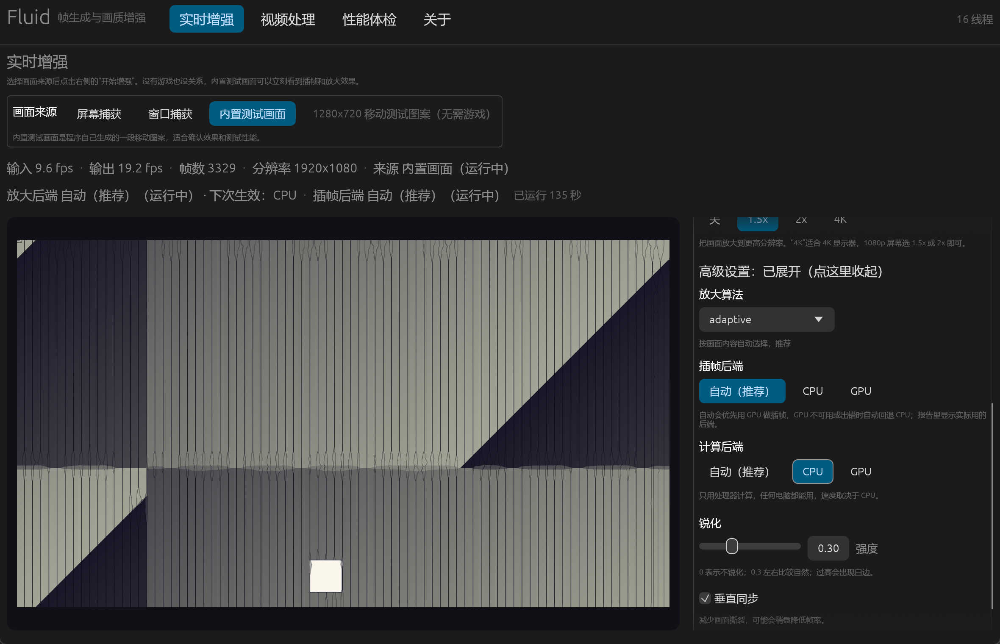
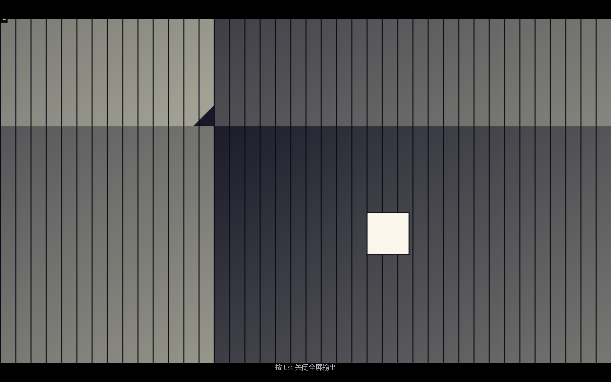
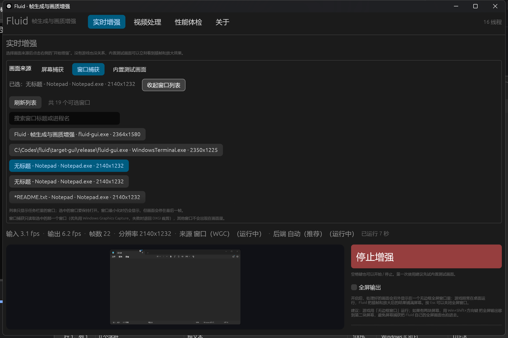
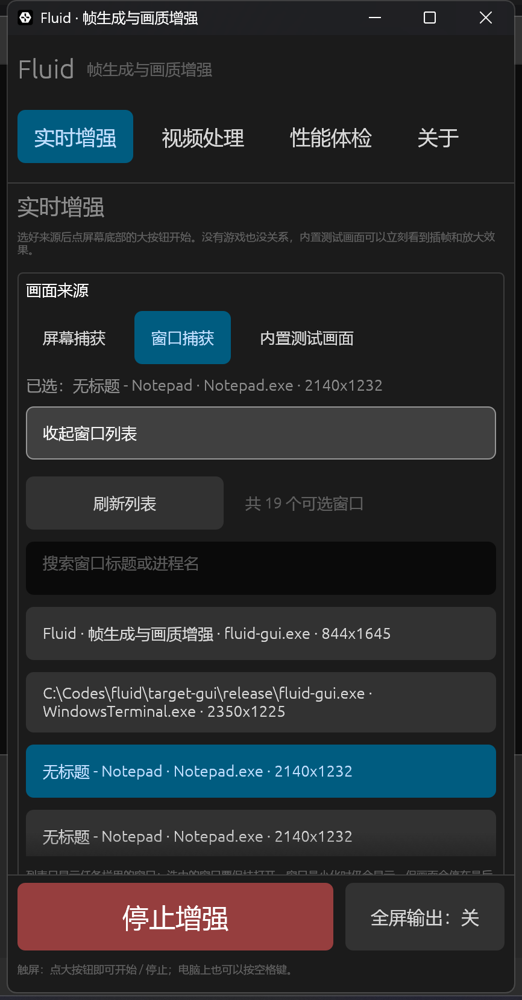
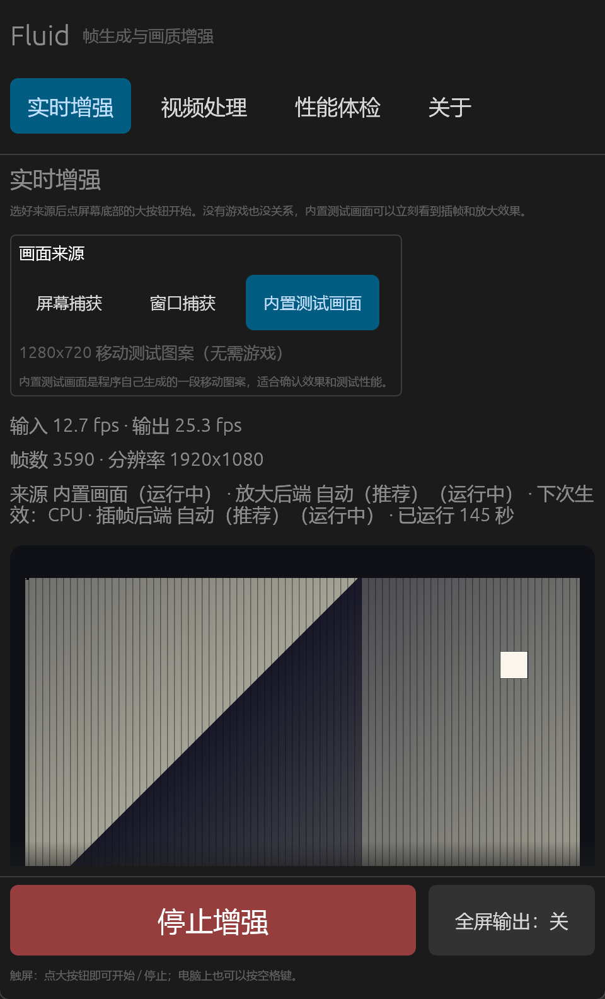

# Fluid 图形界面（GUI）

Fluid 有一个完整的中文图形界面，新手不需要记任何命令行参数：选好来源，点「开始增强」就能看到插帧和放大的效果。

- 桌面端（Windows）：原生窗口程序 `fluid-gui.exe`
- 手机端（Android）：同一套 UI 代码，通过 winit/GameActivity 运行（需要 NDK 构建，见本文末尾）
- CLI `fluid` 与 GUI 共用同一个引擎、同一份配置（`FluidConfig`），所以两边参数完全等价



## 启动

三种方式，任选一种：

```powershell
# 1) 通过 CLI 启动（推荐，会把参数转发给 GUI）
.\target\release\fluid.exe gui

# 2) 直接运行 GUI 可执行文件
.\target\release\fluid-gui.exe

# 3) 从源码构建
cargo build --release -p fluid-gui
```

首次启动会在 `%APPDATA%\Fluid\gui.toml` 创建配置文件，退出时自动保存当前设置。

## 三步上手

1. **选来源**：`屏幕捕获`（整块显示器，可多显示器选择）、`窗口捕获`（只抓一个程序窗口，最省性能、推荐）或 `内置测试画面`（程序自己生成的移动图案，不用开游戏就能看效果）。
2. **选效果**：预设选「均衡」，插帧选「2x」，放大按需要选「关 / 1.5x / 2x / 4K」。
3. **点「开始增强」**：中间的大预览区会实时显示处理后的画面，状态栏显示输入/输出 fps、已处理帧数、分辨率。

想真正玩起来（全屏看增强后的画面）就勾选 **全屏输出**：Fluid 会再开一个无边框全屏窗口只显示画面，游戏窗口放在一边，Fluid 负责把画面插帧+放大后满屏播放。窗口是黑色背景 + 等比铺满（letterbox），左下角前 5 秒会提示「按 Esc 关闭全屏输出」。



全屏输出窗口的生命周期跟运行绑定：停止增强、关闭主窗口、按 Esc 都会把它关掉并自动取消勾选；如果当前图形后端不支持多视口，会自动退回窗口内预览，不会崩溃。

> 关于「镜中镜」：全屏输出窗口已经用 `SetWindowDisplayAffinity(WDA_EXCLUDEFROMCAPTURE)` 从屏幕捕获里排除了（OBS 用户熟悉的「不允许捕获」），所以不会被 Fluid 自己抓进去。但游戏窗口仍然在桌面上，用「屏幕捕获」时画面里会同时有游戏窗口和放大的输出，所以推荐 **游戏用无边框窗口 + 第二块显示器**，或者直接用「窗口捕获」只抓游戏窗口。

### 窗口捕获（最推荐）

只抓一个程序窗口，比抓整块屏幕省很多像素——这是让 1080p/60 这类场景真正跑得动的关键。Windows Graphics Capture 能拿到窗口的真实内容（即使被别的窗口遮住），不需要注入、不需要 hook，和 OBS 用的是同一类系统 API。

1. 画面来源选 `窗口捕获`，点 `选择窗口`；
2. 在列表里搜索标题或进程名（例如 `原神` / `game.exe`），点一行选中；
3. 点 `开始增强`。窗口移动会跟随；窗口尺寸变化时输出尺寸保持不变（多的裁掉、少的补黑），想换尺寸重新开始即可。



- 窗口最小化、被关闭或 GPU 独占时，Fluid 会继续用最后一帧（不会卡死、不会中断）；状态栏会显示来源 `窗口（WGC）`。
- 系统版本低于 Windows 10 2004 会自动退回 DXGI 裁剪模式，此时被遮挡的窗口内容可能不正确，状态栏会显示 `窗口（DXGI 裁剪）`。
- 列表不会自动刷新，换了窗口点 `刷新列表`；上次选的窗口会记住。
- Android 上没有「单个窗口」捕获（MediaProjection 只能整屏），所以手机上这一项是隐藏的。

## 界面说明

### 实时增强

| 控件 | 说明 |
| --- | --- |
| 画面来源 | `屏幕捕获`（DXGI 桌面复制）/ `窗口捕获`（Windows Graphics Capture，推荐）/ `内置测试画面`（合成源，零依赖） |
| 显示器 | 多显示器时选择要捕获的屏幕（`屏幕捕获` 时有效） |
| 窗口列表 | `窗口捕获` 时显示，带搜索框和「刷新列表」；选中后按窗口 ID 捕获，窗口移动会跟随 |
| 预设 | 极速 / 流畅 / 均衡（默认）/ 高画质 / 极致，一键切换全部参数 |
| 插帧 | 关 / 2x / 3x / 4x（输出帧率 = 输入 × 倍数） |
| 放大 | 关 / 1.5x / 2x / 4K（4K 指目标短边或长边见下方说明） |
| 滤波器 | nearest / bilinear / bicubic / lanczos / adaptive（默认）/ temporal |
| 计算后端 | 放大后端：自动（默认，有可用 GPU 就用 GPU）/ CPU / GPU；报告里会显示实际用的后端 |
| 插帧后端 | 插帧后端：自动（默认，优先 GPU）/ CPU / GPU；自动模式下独立显卡总是走 GPU，核显只在小画面（小于约 130 万像素，例如 720p）走 GPU，大画面留在 CPU 更快。插帧倍率为「关」时不可选 |
| 高级设置 | 折叠区，放放大算法、计算后端和插帧后端；桌面默认展开、手机默认折叠，状态会记住 |
| 锐化 | 0 ~ 1 的滑杆，0 关闭；默认 0.3 |
| vsync | 开：画面更稳定、延迟略高；关：延迟最低（报告中可看到 p50/p99 差异） |
| 全屏输出 | 额外的全屏窗口只显示增强结果，适合对着游戏用 |
| 开始增强 / 停止 | 后台线程跑管线，UI 不卡；停止后展示本次运行的统计报告 |

状态栏：`输入 X fps · 输出 Y fps · 帧数 N · 分辨率 WxH · 已运行 N 秒`。刚开始不足 2 个采样时显示「正在测量…」或上一次的值；超过 2 秒没有新画面会提示「停滞」而不是一直显示 0；停止后显示「上次 X fps」。运行中改档位/后端不会打断当前运行，状态栏会显示实际在跑的值并在后面追加「· 下次生效：X」；被捕获的窗口被关闭或最小化时，预览区上方会出现琥珀色提示卡片，带「停止增强」和「重新选择窗口」按钮（管线会继续重复最后一帧，不会崩）。

`--fullscreen-output` 可以让程序启动时就默认勾选全屏输出（配合 `--smoke` 做自动化验证用）。

### 视频处理

离线处理视频，全程不依赖 ffmpeg：

| 控件 | 说明 |
| --- | --- |
| 选择视频… | 系统原生文件对话框，支持 `.y4m`（含 10-bit `p10` 输入，自动截断到 8-bit）和 MJPEG `.avi` |
| 输入信息 | 读出容器、分辨率、帧率、总帧数，例如「输入：y4m（无损，体积大）· 640x360 · 30.00 fps · 约 60 帧」 |
| 另存为… | 原生保存对话框，默认文件名 `<原名>.fluid.<扩展名>`；扩展名决定容器（y4m 或 avi） |
| 输出格式 | `.avi` 输出时出现 JPEG 质量滑杆（40–100，默认 88）；y4m 是无损的，体积大 |
| 参数 | 与实时增强相同：预设、插帧倍率、放大、滤波器、锐化 |
| 开始处理 / 取消 | 后台线程处理，进度条 + 已用时间 + 剩余时间估算（ETA）；取消后保留已完成的部分并在界面上用琥珀色提示 |
| 打开输出文件夹 | 处理完成后直接定位到输出文件 |

完成后显示报告：输入/输出帧数、实际 fps、`static_frames`（静止画面复用帧）、`source_wait_mean_ms`、`present_mean_ms`、放大与插帧的实际后端。需要 mp4/webm 时用 `scripts/video-enhance.ps1`（内部调用 ffmpeg）或先转 y4m，见 [VIDEO.md](VIDEO.md)。

启动时 GUI 会在后台线程预热 GPU（状态栏显示「正在初始化 GPU…」，完成后显示显卡名），这样点「开始增强」不会先卡几秒；没有可用 GPU 时显示 CPU 回退说明。

### 性能体检

一键跑两组合成基准（720p 与 1080p），给出本机实测 fps 和一句推荐（例如「2x 插帧 + 1.5x 放大」）。买电脑前/换游戏前先跑一下，就知道该开什么档位。

### 关于

版本号、许可证（AGPL-3.0）、配置文件路径、快捷键、字体来源，以及「不注入、不读内存、不修改游戏」的安全声明；Android 上还会显示 MediaProjection 的使用说明。

## 快捷键

| 按键 | 作用 |
| --- | --- |
| `Ctrl+1` ~ `Ctrl+4` / `Alt+1` ~ `Alt+4` | 切换四个标签页（部分输入法会占用 `Ctrl+1`，这时用 `Alt+1`） |
| `空格` | 开始 / 停止实时增强 |
| `Esc` | 在主窗口里：停止增强；在全屏输出窗口里：只关闭那个窗口 |

## 命令行参数（GUI 二进制）

```text
fluid-gui [--config <路径>] [--smoke <秒>] [--json-summary <路径>]
          [--width <像素>] [--height <像素>] [--fullscreen-output]
          [--source screen|window|synthetic] [--window-id <ID>] [-h] [-V]
```

| 参数 | 说明 |
| --- | --- |
| `--config <路径>` | 指定配置文件（默认 `%APPDATA%\Fluid\gui.toml`） |
| `--smoke <秒>` | 自动化测试：启动窗口、自动开始内置测试画面，N 秒后自动关闭并打印 `GUI OK` |
| `--smoke-seconds <秒>` | `--smoke` 的别名 |
| `--fullscreen-output` | 启动时就默认勾选「全屏输出」 |
| `--json-summary <路径>` | 退出时写出运行摘要 JSON（帧数、fps、完整管线报告，含实际捕获后端与放大后端） |
| `--width / --height` | 初始窗口尺寸（手机预览就是靠它模拟窄屏），默认按显示器自适应 |
| `--source screen|window|synthetic` | 启动时预设的画面来源 |
| `--window-id <ID>` | 配合 `--source window`，按窗口 ID（十进制或 0x 十六进制）捕获指定窗口 |
| `-V / -h` | 版本 / 帮助 |

`fluid gui` 会把 `--config`、`--smoke` 和 `--` 之后的参数原样转发给 GUI 二进制（查找顺序：`FLUID_GUI_EXE` 环境变量 → 与 `fluid.exe` 同目录的 `fluid-gui.exe` → PATH）。

## 配置文件

GUI 与 CLI 共用 TOML 配置（字段见 README「配置文件」一节）：

- Windows：`%APPDATA%\Fluid\gui.toml`
- Linux：`$XDG_CONFIG_HOME/fluid/gui.toml` 或 `~/.config/fluid/gui.toml`
- 配置文件损坏时不会崩溃：界面顶部给出黄色警告并回退到默认值（原文件保留，可手动修复）

## 常见问题

**预览是黑的？** DRM 保护的内容（部分流媒体）在桌面复制下由系统返回黑帧，这是设计边界；另外确认选的是正确的显示器。

**帧数不够怎么办？** 依次尝试：预设降到「流畅/极速」→ 插帧降到 2x 或关 → 放大关掉（放大比插帧更贵）→ 关闭 vsync。1080p 2x 插帧在这台 12 代 i7 笔记本上约 20-40 fps，720p 明显更快。

**4K 输出在小屏幕上怎么办？** 输出窗口会夹到当前屏幕工作区以内（由 DWM 缩放到屏幕），想要真 4K 需要 4K 显示器；也可以改用 `fluid run` 输出到视频文件再播放。

**界面中文变成方块？** GUI 启动时会自动在系统字体目录里找中文字体（`msyh.ttc`、`simhei.ttf`、`simsun.ttc` 等）；找不到时会退回内置字体并在「关于」页提示。

**窗口捕获列表里找不到游戏？** 游戏要先启动、切到窗口模式；然后点「刷新列表」。独占全屏的游戏没有可捕获的窗口，请改用无边框窗口。

**和游戏反作弊冲突吗？** 不会主动注入或读取游戏；但竞技游戏的服务条款是否允许第三方采集/叠加请以该游戏政策为准，详见 README 的「为什么它安全」。

## Android 现状

- **APK 已构建**：`out/fluid-android-debug.apk`（11.95 MB，arm64-v8a，debug 签名，minSdk 26 / targetSdk 34），APK 里的 `.so` 由 `cargo ndk` 交叉编译，9 个 JNI 导出手工核对过（详见 [ANDROID.md](ANDROID.md)）；
- **手机端的 UI 是 Kotlin 原生界面**，不是把桌面 eframe 界面搬到手机上：三组单选（插帧倍率 关/2x/3x、分辨率提升 关/1.5x/2x、画质三档）、64dp 的开始/停止按钮、500 ms 刷新的状态栏；点开始后走「MediaProjection 授权 → 前台服务 → ImageReader/Surface 交给 Rust → 后台线程跑管线 → ANativeWindow 全屏呈现」；
- **eframe 的 `android_main` 入口仍然保留**（winit 的 `android-game-activity` 路径），但开发机没有真机，这条路径没有在手机上验证过，所以正式 APK 用的是 Kotlin 外壳 + JNI，而不是把 eframe 跑在手机上；
- 没有真机/模拟器，APK 从未安装或启动过：ART 上的 JNI 边界、MediaProjection 取图节奏、ANativeWindow_lockAndPost、旋转/生命周期、真机性能与温控都还没实测，全部列在 [ANDROID.md](ANDROID.md) 的待验证清单里；
- 手机上建议配置：插帧 2x、放大关、画质「流畅」、vsync 开、`max_queue = 1`（APK 里已经默认这样组合）；
- 桌面/平板/窄窗口的界面会自动变成单栏 + 底部大按钮，效果如下（420×800 模拟手机宽度）：



极窄窗口（480×820 逻辑点）会自动切到紧凑模式：标签页收进顶部下拉、底部「停止增强 / 全屏输出」两个大按钮、状态栏折成两行，全部内容不被裁切：



## 与 CLI 的关系

GUI 只是引擎的一层壳：`crates/fluid-gui` 里没有一行采集/插帧/放大算法，全部调用 `fluid-engine`。所以：

- GUI 能调的所有东西，CLI 都能调，反之亦然；
- 做自动化/批处理/服务器环境用 CLI；日常使用用 GUI；
- 两者的实测数字可以直接对照（GUI 的 `--json-summary` 输出的就是引擎的 `PipelineReport`）。
